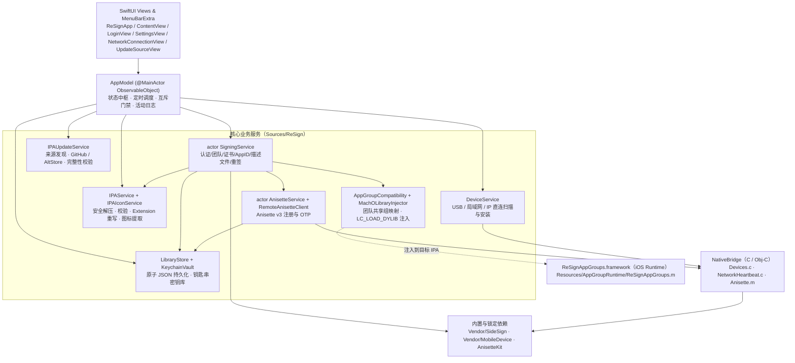

# ReSign 架构说明

本文档为开发者和 AI Coding Agent 提供模块地图、并发边界、存储结构与关键链路不变量的快速索引。

## 系统分层

## 模块职责地图

### `Sources/ReSign/`

| 文件 | 职责 |
| --- | --- |
| `ReSignApp.swift` | `@main` 应用入口、主窗口、`MenuBarExtra`、系统唤醒监听与 `⌘,` 设置菜单 |
| `AppModel.swift` | `@MainActor` 单一状态源，协调设备定时扫描（10s）、更新定时检查（60s 轮询 / 单应用 1h 间隔）、IPA 导入、串行签名安装与回滚 |
| `Models.swift` | 核心数据模型：`ReSignError`、`ConnectedDevice`、`RememberedDevice`、`ManagedApp`（含 `isDue` 调度与退避判断）、`AppUpdateSource`、`AppSettings`、`Library`、`JobStage`、`Activity` |
| `AppTheme.swift` | 外观映射（`AppAppearance`）与浅/深色令牌（`ThemePalette`、`themedCardSurface`、`themedWarningSurface`） |
| `ContentView.swift` | 主界面（`NavigationSplitView`、设备侧边栏、账号入口、状态横幅、应用卡片与最近活动） |
| `LoginView.swift` | Apple 账号登录、Anisette 配置、双重认证交互（设备/短信/语音）与开发团队选择 |
| `SettingsView.swift` | 外观实时预览、续签提前量（12～72h）、登录项（`SMAppService`）、Anisette 配置与 GitHub Token 管理 |
| `NetworkConnectionView.swift` | 局域网 IP 直连地址配置弹窗 |
| `UpdateSourceView.swift` | 软件更新来源候选选择、手动配置与自动更新开关弹窗 |
| `SigningService.swift` | `actor`：Apple 开发者门户会话、证书复用/申请、设备注册、App ID / App Groups 分配、描述文件更新与 `AppBundleSigner` 重签 |
| `AnisetteService.swift` | `actor`：本机（macOS < 27）与远程 Anisette v3 路由、客户端标签兼容（`<Mac OS X;`）与 `AppSettings.authenticationContext` |
| `RemoteAnisetteClient.swift` | Anisette v3 WebSocket 注册（`v3/provisioning_session`）与 OTP 获取（`v3/get_headers`），强制校验 Apple 域名与 `X-Apple-I-MD-RINFO` 路由 |
| `IPAService.swift` | 安全 ZIP 解压（路径穿越/符号链接/特殊文件防护）、主应用与单层 `NSExtension` 检查、FairPlay 加密 Mach-O 拦截、Bundle ID 与扩展版本重写 |
| `IPAIconService.swift` | 仅读取主应用 `Info.plist` 与图标 PNG，选择最高像素候选并缩放为 `<= 256px` PNG 缓存 |
| `AppGroupCompatibility.swift` | 计算团队专属共享组映射 `group.io.resign.<teamID>.<sha256前32位>`、嵌入 `ReSignAppGroups.framework`、写入 `Info.plist` 映射表 |
| `MachOLibraryInjector.swift` | 原地向 arm64/arm64e 单架构或 FAT Mach-O 头部空闲填充区插入 `LC_LOAD_DYLIB` 命令（不破坏段偏移与 fixups） |
| `IPAUpdateService.swift` | IPA 内嵌配置/二进制更新源发现、GitHub Releases（含 Token 与重定向剥离）与 AltStore JSON 解析、文件大小/SHA-256/Bundle ID/最低系统版本/防降级校验 |
| `DeviceService.swift` | 封装 `NativeBridge` 的设备枚举、单播 IPv4/IPv6 校验与 AFC/Installation Proxy 安装 |
| `LibraryStore.swift` | 管理 `~/Library/Application Support/io.resign.mac/`（`0o700` 权限）、`library.json` 原子读写与缓存文件名路径逃逸防护 |
| `KeychainVault.swift` | 封装 `Security.framework` 通用密码项（`kSecAttrAccessibleAfterFirstUnlockThisDeviceOnly`） |

### `Sources/NativeBridge/` 与 `Resources/AppGroupRuntime/`

| 文件 | 职责 |
| --- | --- |
| `include/NativeBridge.h` | Swift 互操作头文件，声明 `rs_devices_json`、`rs_network_device_json`、`rs_local_anisette_json`、`rs_install`、`rs_free` |
| `Devices.c` | 基于 `Vendor/MobileDevice`（`ReSignMobileDevice`）的设备发现、USB 优先去重、IP 直连身份/TLS 证书校验与 AFC + Installation Proxy 安装 |
| `NetworkHeartbeat.c` / `.h` | IP 直连期间维持 iOS `com.apple.mobile.heartbeat` 无线心跳会话，防止长时间传输中断 |
| `Anisette.m` | 旧式本机 macOS AOSKit 认证桥接（macOS 27 上不可用，仅保留兼容分支） |
| `Resources/AppGroupRuntime/ReSignAppGroups.m` | 独立编译的 iOS arm64/arm64e 动态框架；在 `+load` 时校验 `ReSignAppGroupMappings` 并 swizzle `NSFileManager` 容器路径与 `NSUserDefaults` suite 访问 |

## 并发与状态互斥模型

- **`AppModel`（`@MainActor`）**：所有 UI 状态更新和 `library.json` 提交（`commit(_:)`）均在主线程串行执行。
- **操作互斥门禁**：
  - `isBusy`：IPA 导入、续签/安装队列、更新检查下载、恢复上一份 IPA 期间置为 `true`，阻断并发修改与退出。
  - `isScanning`：设备扫描期间置为 `true`，与导入/安装/IP 修改互斥，避免安装期间干扰无线连接。
  - `isLoggingIn`：登录与 2FA 期间置为 `true`，使用 `CheckedContinuation` 桥接用户输入与 `DeveloperPortal` 回调。
  - `isCheckingUpdates`：更新检查期间置为 `true`，阻止同时修改更新源。
- **后台隔离**：
  - `SigningService` 与 `AnisetteService` 为 Swift `actor`。
  - 阻塞型 C 调用（`DeviceService`）、ZIP 解压/重检查、图标提取均通过 `Task.detached` 离开主线程执行。
- **失败退避与自动暂停**：
  - 单次非登录类续签失败后 `failedAttempts += 1`，退避延迟为 `min(6h, 15min * 2^(failedAttempts - 1))`；连续失败 5 次后暂停自动重试（设备重新上线可清零未满 5 次的 `nextAttemptAt`，手动“立即续签”或重新登录同团队可恢复）。

## 持久化与密钥清单

### 磁盘布局：`~/Library/Application Support/io.resign.mac/`（权限 `0o700`）

- `library.json`：`Library` 根结构（`schemaVersion = 1`，pretty-printed + sorted keys，`.atomic` 写入）。
- `IPAs/<uuid>.ipa`：每个托管应用独立缓存的安装源（以及待安装更新前的单份回滚副本 `previousIPAFilename`）。
- `Icons/<uuid>.png`：从主应用提取的 `<= 256px` 图标缓存。
- `Work/<uuid>/`：导入、更新检验、重签用的临时工作区，完成后清理。

### macOS Keychain（`kSecAttrService = "io.resign.mac"`）

| Key | 存储内容 | 说明 |
| --- | --- | --- |
| `account` | `SavedAccount`（`AuthSession`、`Team`、`context`） | 退出账号时删除；不存储 Apple 账号密码 |
| `certificate-<teamID>` | `SavedCertificate`（证书 DER、私钥、identifier） | 退出账号后保留，供同团队复用 |
| `anisette-v3-routing-<sha256>` | `RemoteIdentity`（UUID、`adiBlob`、`routingInfo`） | 按 `server + clientInfo + userAgent` 隔离缓存 |
| `github-update-token` | `String`（GitHub PAT） | 仅向 `https://api.github.com` 携带，跨主机重定向时自动剥离 |

## 关键业务流水线

1. **IPA 导入与重签**：`IPAService.extract`（安全解压）→ `IPAService.inspect`（校验主应用/扩展/非加密 Mach-O/App Groups）→ `AppGroupCompatibility.identifiers` & `prepare`（如需重映射则嵌入框架并注入 `LC_LOAD_DYLIB`）→ 开发者门户（证书/设备/App ID/App Groups/描述文件）→ `IPAService.normalizeExtensionVersions` & `rewriteBundleIDs` → `AppBundleSigner.signApp` → `zipAppBundle` → `DeviceService.install`。
2. **版本自动更新与单份回滚**：`IPAUpdateService.discover`（导入时识别）→ 每小时检查 `release(for:)` → `download`（校验大小与 SHA-256）→ `inspectUpdate`（校验原始 Bundle ID、版本、系统兼容性）→ `isNewer` 防降级 → 保留原文件名到 `previousIPAFilename` 并标记 `pendingInstall = true` → 设备在线后重签安装成功再清理旧副本（失败可随时执行 `restorePreviousIPA` 回滚并暂停自动更新）。
